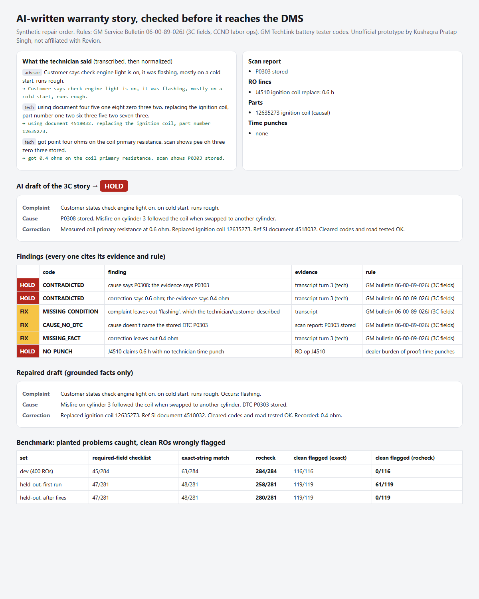

# Warranty story check: AI-written repair orders, verified before they reach the DMS

> Unofficial prototype by Kushagra Pratap Singh. Not affiliated with Revion. Synthetic repair orders. Rules from public GM warranty documents; not legal or OEM advice, and other OEMs differ.

## The problem

Revion automates technicians' admin work, which they put at 30–40% of the day. Their job posts mention tuning "voices and transcribers" and writing into Pinewood, Keyloop and Reynolds DMS ([YC](https://www.ycombinator.com/companies/revion)). The most valuable piece of that admin work is the **repair-order story** (complaint / cause / correction) that a warranty claim is paid on, and audited on months later.

What a warranty story must contain is public. GM Service Bulletin **06-00-89-026J** (Warranty Administration, Nov 2012, [on NHTSA](https://static.nhtsa.gov/odi/tsbs/2012/MC-10126192-9999.pdf)):
- The **complaint** answers who/what/when/where: which warning light, intermittent or consistent, operating conditions.
- The **cause** names "the DTC Code found or displayed symptom".
- The **correction** "should not recap the service procedure". It should give "all test measurements, diagnostic trouble codes, circuit numbers, connector number/names, document ID number from SI".
- **J9992** (engine CCND) needs an engine P-code in the dependency field. B/C/U codes are not allowed, and P0700 is transmission.
- **CCND ops** get 0.1–0.3 h on actual clock time, with service-manager approval on the RO.

[GM TechLink](https://gm-techlink.com/?p=14775) adds that a **battery** claim needs the tester code: 15 or 20 characters, no I/O/Y/Z, matching VIN, never reused. Auditors put "the burden of proof on the dealer", and "lack of technician time punches" is a common chargeback ([one-view](https://www.one-view.com/academy/service-warranty-audit/)).

An LLM drafting that story from a technician's voice can:
- swap a digit in the DTC;
- shift a reading;
- invent a measurement it never heard;
- smooth the correction into a procedure recap;
- drop the "flashing, on cold start" the customer described.

On top of that, the tech said "pee zero three oh three" and "point four ohms", so a plain text match can't verify anything.

## What I built

`rocheck` takes the transcribed technician notes, the scan report, the RO lines and the AI draft, and returns **READY / FIX / HOLD**. Every finding cites its evidence (transcript turn, scan line, RO line) and the rule it comes from.

| part | what it does |
|---|---|
| `spoken.py` | technician speech → written forms: `pee zero zero see six` → P00C6; `eleven point eight volts` → 11.8 V; `two fifty psi` (shop shorthand) → 250 psi; `pounds` → psi or ft-lb from the sentence (pressure vs torque words); digit-by-digit part numbers and SI document IDs; `ex two` → X2 |
| `facts.py` | facts an auditor checks: DTCs, measurements with units (glued `11.8V`, `0.4Ω`, `58 °F`), 8-digit part numbers, 7-digit SI docs, connectors, circuits, cylinders, complaint conditions. Spec ranges (`spec 0.3-0.6 ohm`) are not facts about this car and are skipped |
| `check.py` | **grounding:** each fact in the draft is SUPPORTED, CONTRADICTED (the same kind of fact with a different value: P0308 vs P0303, 0.6 vs 0.4 ohm) or UNSUPPORTED. **3C completeness:** conditions said but missing from the complaint, cause without the stored DTC, measurements/connectors/circuits/SI doc said but left out, recap-only correction. **RO:** J9992 dependency rules, CCND hours/approval/clock/same-group, no time punch, causal part not in the story, battery code length/letters/VIN/reuse. **Repair:** drops sentences with unbacked facts and fills gaps from the evidence |



## Results

400 synthetic ROs per set across 10 jobs: misfire/coil, battery, ABS CCND, engine MIL CCND, A/C, oil leak, EVAP, TPMS, wheel bearing, shift solenoid. About 30% are clean drafts; the rest carry one of 18 planted defects. Truth comes from the generator. The **held-out phrase bank** was **committed to git before its first run**. It has different ways techs talk (NATO letters, hyphenated codes, "pounds", "mil") and different ways drafts write (`58 °F`, `0.4Ω`, `R&R … (P/N)`).

| set | required-field checklist | exact-string match | **rocheck** | clean ROs flagged: exact | **clean ROs flagged: rocheck** |
|---|---|---|---|---|---|
| dev | 45/284 | 63/284 | **284/284** | 116/116 | **0/116** |
| **held-out, first run** | 47/281 | 48/281 | **258/281** | 119/119 | **61/119** |
| held-out, after the fixes below | 47/281 | 48/281 | 280/281 | 119/119 | 0/119 |

The checklist only sees empty fields. It catches no-punch and no-DTC, but not one wrong number. Exact-string matching catches invented facts, but flags **every** clean story, because techs don't speak in "P0303".

### The held-out first run, as it happened

It caught 258 of 281 problems but **wrongly held 61 of 119 clean stories**. The causes, all real-world speech:
- **"58 pounds"** means psi in shop talk. My normalizer didn't know that, so true readings looked invented. Fixed: "pounds" becomes psi next to pressure words and ft-lb next to torque words, within the same sentence.
- **"0.3 mil"** (millimetres) set off the check-engine-lamp condition. Fixed: "MIL" counts only as a lamp ("MIL on", "the MIL").
- Draft wordings the condition list didn't know: "ABS warning lamp", "harsh 2-3 shift". Patterns were added.
- **Number context crossed sentences:** "SI doc ID 3410982. measured 28 pounds" made 28 a document number. It now stays in the sentence.
- `(23353254).` lost its part number to punctuation, and `58degrees` / `58 °F` weren't read as units. Both fixed.

After these fixes the same held-out set gives 280/281 caught and 0/119 clean flagged. It is **no longer an untouched test set**, so the honest number to quote is the first run.

**During the build (dev only):**
- My generator's "correct" misfire story mentioned cylinder 2 for a coil swap the tech never described. The checker flagged it, and the generator was wrong.
- One "wrong measurement" mutation rounded back to the same value.

**Limits:**
- These are the rules from one OEM's public documents. Ford, Stellantis and UK manufacturer warranty manuals differ, which is why the rules live in one file.
- Condition detection is a phrase list. It will miss new slang.
- Transcripts are text with spoken forms. No audio or ASR errors beyond that.

## Run it

```
python demo.py                # one RO end to end -> out/report.html
python evaluate.py heldout    # or: dev
python -m pytest -q           # 7 tests
```

Python 3.10+, standard library only (pytest for tests).
